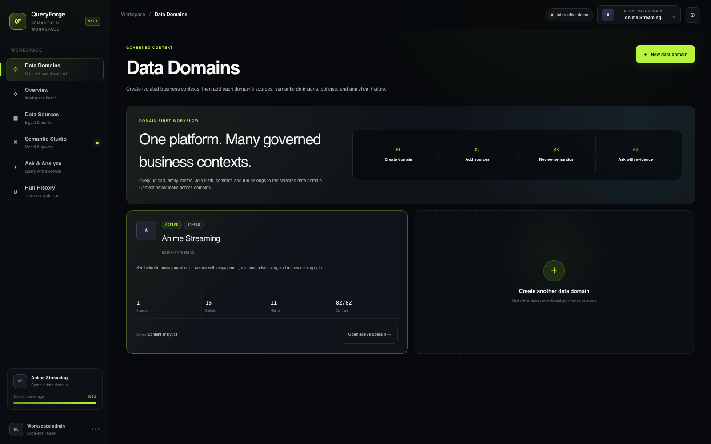
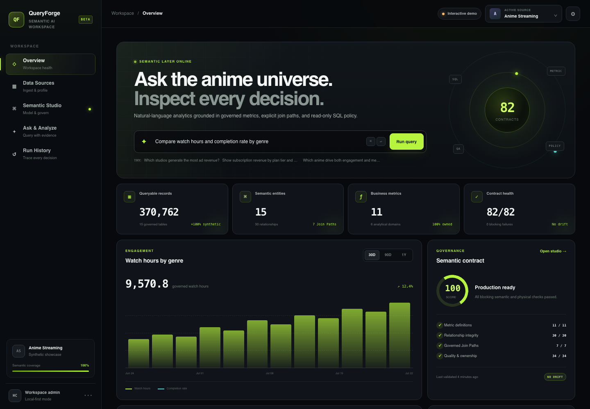
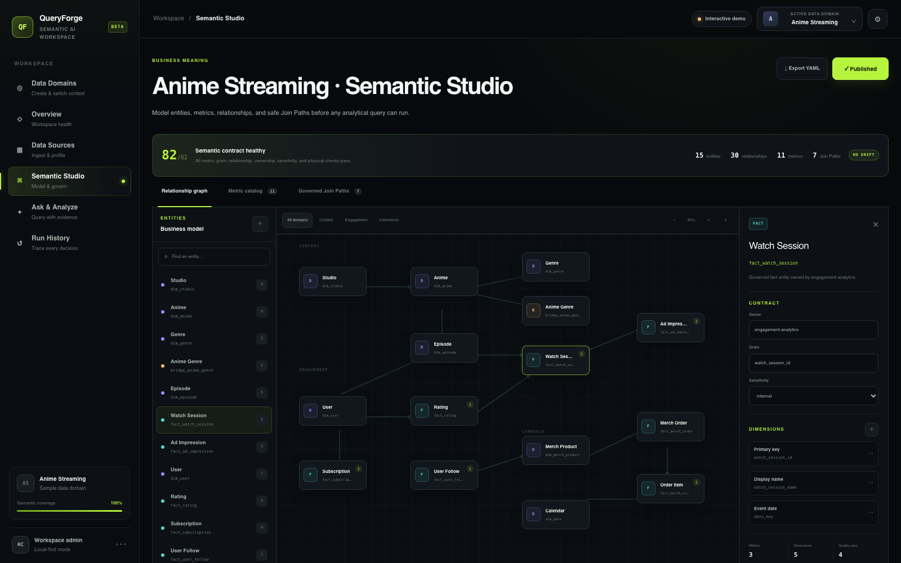
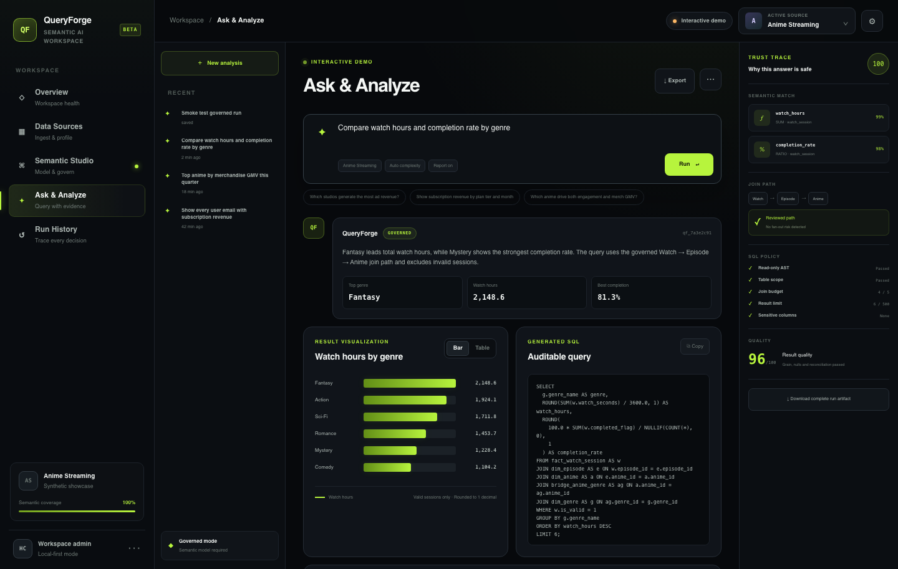
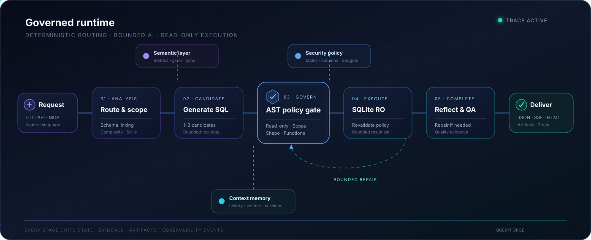
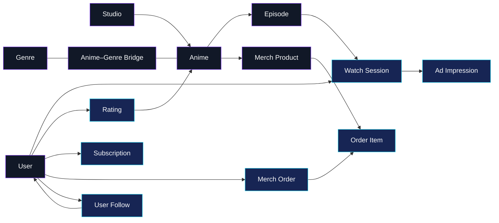

<div align="center">



# QueryForge

### Governed AI analytics, from natural language to auditable SQL

Turn business questions into safe, traceable SQLite queries—with a semantic layer,
policy enforcement, bounded recovery, and production-friendly delivery interfaces.

[简体中文](README.zh-CN.md) · [Quick start](#quick-start) · [Architecture](#how-it-works) · [Documentation](#documentation)


</div>

---

QueryForge is a local-first, domain-first AI data analytics platform built around
one principle:
**generated SQL should be governed like application code, not trusted like prose**.

Users create or select a data domain first—such as retail, finance, product, or
the bundled Anime Streaming sample—then onboard that domain's data, review its
semantic contract, and ask questions inside the same governance boundary.
QueryForge combines that workflow with natural-language-to-SQL, AST-level
security, read-only execution, bounded recovery, and complete run artifacts.

> Studio serves local single-user workflows with read-only SQLite analysis by default.

## Product Tour

<div align="center">
  
  <sub>Data Domain Center — create or select a governed context before adding data or semantics.</sub>
</div>

<br>

<div align="center">
  
  <sub>Domain overview — the Anime Streaming dataset is shown as one selected sample, not the platform identity.</sub>
</div>

<br>

<div align="center">
  
  
  <br>
  <sub>Semantic Studio &nbsp;·&nbsp; Governed analysis with auditable SQL and Trust Trace</sub>
</div>

## Why QueryForge?

Most NL2SQL demos stop after a model emits a query. QueryForge covers the full
delivery loop:

| Need | QueryForge approach |
| --- | --- |
| Trust the generated SQL | Parse with SQLGlot and enforce a named policy before execution |
| Keep business meaning consistent | Define metrics, dimensions, grain, and join paths in YAML |
| Prevent context from leaking | Scope sources, semantic contracts, policies, and run history to a selected data domain |
| Recover from imperfect output | Reflect, repair, and retry within explicit budgets |
| Handle harder questions | Use bounded schema discovery, a tool loop, and serviceable failure classification |
| Trace what happened | Persist run state, policy decisions, quality evidence, and artifacts |
| Integrate with other tools | Expose CLI, REST/SSE, MCP, gateway, JSON, charts, and HTML reports |
| Start from raw data | Build governed SQLite assets from CSV, Parquet, and paginated JSON APIs |

## Quick Start

### 1. Install

Requirements: **Python 3.11 or 3.12**; Studio uses **Node.js 22**.

```bash
python3.12 -m venv .venv
source .venv/bin/activate
python -m pip install --upgrade pip
python -m pip install -e .
cp -n .env.example .env
```

### 2. Configure a model

Set one provider in `.env`. OpenAI-compatible, Claude, Gemini, Qwen, DeepSeek,
and GLM configurations are included.

```dotenv
LLM_PROVIDER=deepseek
DEEPSEEK_API_KEY=your-api-key
```

Provider defaults and environment-variable mappings live in [`models.yml`](models.yml).

### 3. Run the bundled example

```bash
queryforge --prepare-sample-data

queryforge \
  --database sample_data/anime_streaming/anime_streaming.sqlite \
  --question "Which anime generated the most watch hours?"
```

Try a multi-hop semantic query:

```bash
queryforge \
  --database sample_data/anime_streaming/anime_streaming.sqlite \
  --semantic-model sample_data/anime_streaming/semantic_model.yml \
  --sql-policy sample_data/anime_streaming/sql_policy.yml \
  --question "Compare watch completion and merchandise GMV by anime genre"
```

### Explore QueryForge Studio

Create a domain, upload CSV/Parquet, review semantics and publish. Then query,
inspect SQL and Trust Trace, or replay saved results bound to their data version.

```bash
# Terminal 1: QueryForge API
python -m pip install -e ".[api,assets]"
queryforge --serve-api --api-host 127.0.0.1 --api-port 8000

# Terminal 2: QueryForge Studio
make web-install
make web-dev
```

Open <http://localhost:3000>. Start in **Data Domains**, select the bundled Anime
Streaming example or create a clean domain, then add data inside that domain. If
the Python API is offline, the sample-domain analysis remains explorable with a
deterministic demo response. See the [Studio guide](docs/studio.md).

## How It Works

<div align="center">
  
</div>

The public lifecycle stays intentionally small:

```text
analysis → candidate → execution → completion → delivery
```

Role-specific agents operate inside those stages. A deterministic router chooses
the path; the model does not control the security boundary.

## SQL Governance

Every generated query passes through an auditable pipeline:

```text
SQL candidate
  → SQLite AST parse
  → single read-only statement
  → table and column scope
  → dangerous-function checks
  → recursive CTE and cross-join checks
  → table, join, and LIMIT budgets
  → measure, filter and active-output checks
  → governed preview
  → execution-boundary revalidation
```

A policy can be as small as:

```yaml
version: 1
name: anime_streaming
allowed_tables:
  - fact_watch_session
  - dim_anime
require_limit: true
max_limit: 500
max_tables: 2
max_joins: 1
allow_cross_join: false
```

Policy denials return a structured `SQL_SECURITY_ERROR` before SQLite execution.

## Semantic Layer

QueryForge's YAML semantic models give generated SQL business context that raw
schemas cannot provide:

```yaml
metrics:
  - name: watch_hours
    description: Total valid viewing time in hours.
    entity: watch_session
    aggregation: sum
    expression: SUM(fact_watch_session.watch_seconds) / 3600.0
    default_filters:
      - fact_watch_session.is_valid = 1
    owner: audience-analytics
    sensitivity: internal
```

Models define entities, dimensions, measures, grain, relationships and quality
rules. Queries require a validated model by default and auto-discover nearby YAML.
Independent facts aggregate before joining; ratios use declared components, and
each measure follows its event time, unit and reviewed coverage. Change diagnostics
return category contributions, independently reconciled totals and evidence.

Studio onboarding follows:

```text
Create/select domain
  → upload CSV/Parquet
  → review entity, grain, dimensions and measures
  → confirm owner and sensitivity
  → validate physical data and semantic contracts
  → publish data + semantics
```

New domains start with an empty contract. Studio edits single-entity dimensions
and measures; complete relationships, time and units are authored in YAML.
Queries require successful physical publication. Skill prefiltering and
content-version caches reduce unused context; repair and candidate previews have
explicit budgets. History preserves the original domain and data version, while
expired reports can be quarantined for recovery.

Build or incrementally refresh one:

```bash
python scripts/build_semantic_model.py \
  --database warehouse.sqlite \
  --output warehouse.semantic.yml \
  --owner data-platform
```

The generated report separates high-confidence physical evidence from definitions
that need business review. See [Semantic layer authoring](docs/semantic_authoring.md)
and [Semantic contracts](docs/semantic_contracts.md).

The repository also includes a Monday-morning
[semantic drift workflow](.github/workflows/semantic-weekly.yml) that checks schema,
metrics, relationships, Join Paths, and data-quality contracts against a reviewed
baseline.

### Bundled sample domain: Anime Streaming

Anime Streaming is one ready-to-run example data domain, not a product-wide
schema. The dataset is purpose-built for QueryForge and fully synthetic: **370,762
rows**, **15 tables**, **30 declared relationships**, **7 governed Join Paths**, and
**11 business metrics** across content, engagement, subscriptions, advertising,
community, and merchandise.



See the [dataset contract](sample_data/anime_streaming/README.md), inspect the
[semantic model](sample_data/anime_streaming/semantic_model.yml), or regenerate
the database and optional CSV exports with
`python sample/generate_anime_streaming.py`.

## Common Workflows

### Preview a plan without executing SQL

```bash
queryforge \
  --plan-mode \
  --question "Compare monthly watch hours by subscription tier"
```

### Enable the complex execution profile

```bash
queryforge \
  --complexity-mode complex \
  --parallel-candidates 3 \
  --question "Explain completion-rate changes by genre, device, and membership tier"
```

### Stream progress or create a report

```bash
queryforge --stream --question "List the top ten anime by watch hours"
queryforge --report --question "Build a report for monthly engagement by genre"
```

### Build a governed data asset

```bash
python -m pip install -e ".[assets]"

python scripts/scaffold_data_asset.py \
  --source events.csv \
  --output events.assets.yml \
  --owner engagement-analytics

# Review the semantic draft and set semantic_model.reviewed: true.
python scripts/build_data_assets.py \
  --config sample_data/data_assets/assets.yml \
  --publish-database .queryforge/demo/analytics.sqlite
```

Every uploaded asset must carry entity semantics. Data and semantics publish
atomically, so a failed metric, relationship, grain, or quality contract rolls the
whole upload back.

### Start the REST API

```bash
python -m pip install -e ".[api]"
queryforge --serve-api --api-host 127.0.0.1 --api-port 8000
```

```bash
curl -X POST http://127.0.0.1:8000/ask \
  -H 'content-type: application/json' \
  -d '{
    "question": "List the ten anime with the highest completion rate",
    "database": "sample_data/anime_streaming/anime_streaming.sqlite"
  }'
```

### Start the MCP server

```bash
python -m pip install -e ".[mcp]"
python -m queryforge.interfaces.mcp.server --transport stdio
```

## Interfaces

| Surface | Entry point | Best for |
| --- | --- | --- |
| Studio | `make web-dev` | Data-domain management, visual onboarding, semantic authoring, and governed analysis |
| CLI | `queryforge --question "..."` | Local exploration and engineering workflows |
| REST | `POST /ask` (conversational), `POST /analyze` (planner) | Application integration |
| SSE | `POST /ask/stream` | Progress-aware clients |
| MCP | `queryforge.interfaces.mcp.server` | IDEs and MCP-compatible assistants |
| Gateway | `POST /gateway/webhook` | Stable user/channel session adapters |
| Artifacts | JSON, Vega-Lite, SVG, HTML | Review, sharing, and audit |

## Project Structure

```text
queryforge/
├── cli.py             # Installed CLI implementation
├── application/       # Transport-neutral service facade and resources
├── core/              # Configuration, schemas, workspace paths, observability
├── data_assets/       # Ingestion, quality, lineage, and publication
├── domain/            # SQL policy, semantics, contracts, and skills
├── infrastructure/    # Database adapters, model providers, storage, and tools
├── evaluation/        # Benchmark thresholds and evaluator-side contract rules
├── interfaces/        # CLI-adjacent API, MCP, and gateway adapters
├── orchestration/     # Router, role agents, lifecycle, and state
├── workflow/          # NL2SQL nodes, selection, repair, and reporting
└── bundled_skills/    # Prompt-only skill definitions shipped with the package

evaluation/gold/       # Multi-domain NL2SQL evaluation cases
evaluation/tasks/      # Deterministic agent-benchmark tasks (dev/regression/holdout)
sample_data/           # Ready-to-run SQLite datasets and semantic models
web/                   # QueryForge Studio and local D1/R2 storage
scripts/               # Build, benchmark, evaluation, and acceptance tools
tests/                 # Unit, integration, boundary, and acceptance tests
docs/                  # Architecture and feature documentation
.github/               # CI, semantic drift audit, and contribution templates
```

Dependencies flow inward from interfaces and application code toward domain,
infrastructure, and core contracts.

## Development Checks

```bash
./init.sh             # environment and offline tests
make check            # repository hygiene and full acceptance
make semantic-check   # semantic-model drift
make web-check        # Studio lint, types, build and tests
```

Evaluation separates deterministic governance checks from real-model behaviour.
See the [evaluation guide](docs/nl2sql_evaluation.md) for benchmark commands and result interpretation.

## Documentation

| Topic | Guide |
| --- | --- |
| Architecture | [Agent team architecture](docs/agent_team_architecture.md) |
| Configuration | [Configuration reference](docs/configuration.md) |
| Studio | [Visual workspace and semantic onboarding](docs/studio.md) |
| REST API | [API reference](docs/api_reference.md) |
| MCP | [MCP server](docs/mcp_server.md) |
| Semantic layer | [Semantic contracts](docs/semantic_contracts.md) |
| Semantic authoring | [Build, review, and require semantic models](docs/semantic_authoring.md) |
| Data assets | [Data asset builds](docs/data_assets.md) |
| Evaluation | [NL2SQL evaluation](docs/nl2sql_evaluation.md) |
| Reports | [Report artifacts](docs/report_artifact.md) |
| Subject scoping | [Subject tree](docs/subject_tree.md) |
| Documentation index | [All guides](docs/README.md) |

## Contributing and Security

- [Contributing guide](CONTRIBUTING.md)
- [Security policy](SECURITY.md)
- [Code of conduct](CODE_OF_CONDUCT.md)
- [Changelog](CHANGELOG.md)

No open-source license has been declared.

## Deployment and Security

Studio binds locally and enforces same-origin requests. Analysis permits read-only
SQL. REST/MCP serve controlled environments; local credentials belong in the
ignored `.env`.

- `QUERYFORGE_API_KEY`: enable REST/Gateway request authentication.
- `DATABASE_ALLOWLIST` / `REPORT_ROOT_ALLOWLIST`: restrict data and report roots.
- `REPORT_RETENTION_DAYS`: set report access lifetime; the default is 30 days.

SSE disconnects cancel cooperatively at execution boundaries. Domain history
preserves its original data version. See [configuration](docs/configuration.md).

## Roadmap

- Database adapters beyond SQLite
- First-class authentication and tenant policy boundaries
- Durable workflow execution and cancellation
- Warehouse-catalog integrations
- Provider-independent usage and cost accounting

Contributions and design discussions are welcome after the repository license is selected.
